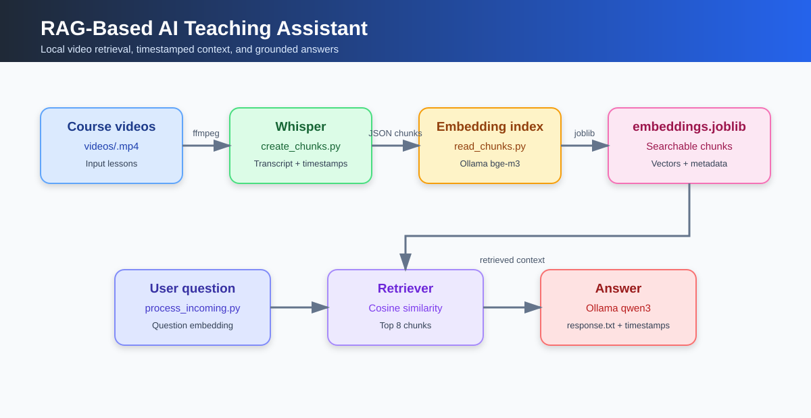

# RAG-Based AI Teaching Assistant

This repository contains a local, script-based Retrieval-Augmented Generation (RAG)

teaching assistant for video courses. It transcribes course audio, stores timestamped

subtitle chunks, creates semantic embeddings, retrieves the most relevant chunks for a

question, and asks a local language model to answer with the relevant video and

timestamps.



## What the project does

The current implementation follows this pipeline:

1. Convert course videos to audio with `ffmpeg`.

2. Transcribe each audio file with OpenAI Whisper (`small` model).

3. Store Whisper segments as JSON records containing the video title, text, and

   start/end timestamps.

4. Generate an embedding for every segment using Ollama's `bge-m3` model.

5. Save the embedded segments to `embeddings.joblib`.

6. Embed a user's question, rank all stored chunks with cosine similarity, and select

   the top eight results.

7. Send the retrieved context to Ollama's `qwen3` model.

8. Save the generated answer to `response.txt`.

The intended use case is asking questions about the lessons and being directed to the

most relevant video sections instead of receiving raw transcript text.

## Architecture

```text

videos/ ──ffmpeg──> audios/ ──Whisper──> jsons/\*.json

                                             │

                                             └── Ollama bge-m3 ──> embeddings.joblib

                                                                        │

question ── bge-m3 ──> cosine similarity ── top 8 chunks ── qwen3 ──> response.txt

```

## Requirements

\- Python 3.9 or newer

\- `ffmpeg` available on `PATH`

\- [Ollama](https\://ollama.com/) running locally at `http\://localhost:11434`

\- Enough disk space and memory for Whisper and the local Ollama models

Install the Python dependencies:

```bash

python -m venv .venv

source .venv/bin/activate              # Windows: .venv\Scripts\activate

python -m pip install --upgrade pip

pip install openai-whisper requests pandas numpy scikit-learn joblib

```

Install the models used by the scripts:

```bash

ollama pull bge-m3

ollama pull qwen3

```

Verify Ollama is running before creating embeddings:

```bash

curl http\://localhost:11434/api/tags

```

## Directory and file guide

| Path | Purpose |

| --- | --- |

| `process_video.py` | Converts files in `videos/` to MP3 files in `audios/` using `ffmpeg`. |

| `create_chunks.py` | Transcribes every file in `audios/` with Whisper and writes timestamped JSON to `jsons/`. |

| `read_chunks.py` | Embeds every JSON chunk through Ollama and writes the searchable DataFrame to `embeddings.joblib`. |

| `process_incoming.py` | Accepts a question, retrieves the eight closest chunks, calls `qwen3`, and writes the answer. |

| `unused/stt.py` | An older standalone transcription experiment; it is not part of the main pipeline. |

| `videos/` | Input video files. Ignored by Git because media files can be large. |

| `audios/` | Intermediate MP3 files. Ignored by Git. |

| `jsons/` | Transcript chunks and their timestamps. |

| `embeddings.joblib` | Serialized pandas DataFrame containing chunks and embedding vectors. |

| `prompt.txt` | The exact prompt generated for the last question. |

| `response.txt` | The answer generated for the last question. |

| `docs/architecture.svg` | The architecture diagram included in this README. |

## Running the pipeline

### 1. Add course videos

Create the ignored input directory and place one or more videos inside it:

```bash

mkdir -p videos audios jsons

cp /path/to/lesson.mp4 videos/

```

### 2. Convert videos to audio

```bash

python process_video.py

```

### 3. Create timestamped transcript chunks

```bash

python create_chunks.py

```

The script loads Whisper's `small` model and writes one JSON file per audio file. Each

chunk has this shape:

```json

{

  "title": "lesson",

  "start": 2.8,

  "end": 5.3,

  "text": "And this is after color grading."

}

```

### 4. Build the embedding index

```bash

python read_chunks.py

```

`read_chunks.py` sends the list of chunk texts to Ollama's `/api/embed` endpoint using

`bge-m3`, adds a `chunk_id` and `embedding` field to every chunk, and serializes the

result to `embeddings.joblib`.

### 5. Ask a question

```bash

python process_incoming.py

```

Enter a course-related question when prompted. The script embeds the question, computes

cosine similarity against every stored chunk, selects the eight highest-scoring rows,

and sends their title, timestamps, and text to `qwen3`. Inspect:

\- `prompt.txt` for the retrieved context and generated prompt.

\- `response.txt` for the final answer.

## Retrieval and answer behavior

\- Query and transcript chunks use the same `bge-m3` embedding model.

\- Similarity is calculated with scikit-learn's `cosine_similarity`.

\- Exactly eight results are requested by the current script (`top_results = 8`).

\- The generation request uses `qwen3`, temperature `0.2`, and `num_predict = 512`.

\- The prompt asks the model to cite the relevant video and timestamp and to refuse

  unrelated questions as outside the course scope.

\- The current implementation is a command-line workflow; it does not expose a web API

  or interactive user interface.

## Important implementation notes

\- `process_video.py` currently writes every converted file to `audios/1.mp3`. If more

  than one video is processed, output names can overwrite one another. Rename the

  output using the source filename before using the script for multiple lessons.

\- `process_video.py` expects `videos/` and `audios/` to already exist.

\- `create_chunks.py` expects audio files under `audios/` and writes into `jsons/`.

\- `read_chunks.py` expects every JSON file in `jsons/` to contain a top-level

  `chunks` array with `text` values.

\- Ollama failures are not converted into friendly application errors; check that the

  service is running and that both model names are installed.

\- `embeddings.joblib`, `prompt.txt`, and `response.txt` are generated artifacts. The

  checked-in versions document the current sample run, but should be regenerated when

  the course content changes.

\- Audio/video inputs and virtual environments are ignored by `.gitignore` and should

  not be committed.

## Troubleshooting

**\*\*`Connection refused` from `localhost:11434`\*\***  

Start Ollama, then verify it with `curl http\://localhost:11434/api/tags`.

**\*\*`model not found` from Ollama\*\***  

Run `ollama pull bge-m3` and `ollama pull qwen3`. The model names are hard-coded in

`read_chunks.py` and `process_incoming.py`.

**\*\*`FileNotFoundError` for `videos`, `audios`, or `jsons`\*\***  

Create the directories with `mkdir -p videos audios jsons` before running the scripts.

**\*\*Whisper installation or audio decoding errors\*\***  

Confirm that `ffmpeg` is installed and available on `PATH`, then retry the Python

environment installation.

## Current sample

The repository includes sample transcript data for a color-grading course. The checked

sample response identifies sections about film compression and bloom in video 1 and

provides their timestamps.

## License and project status

No license file is currently included. Add a license before distributing the project.

This is an experimental local prototype: model names, prompt wording, retrieval count,

and output paths are intentionally configured directly in the Python scripts.
